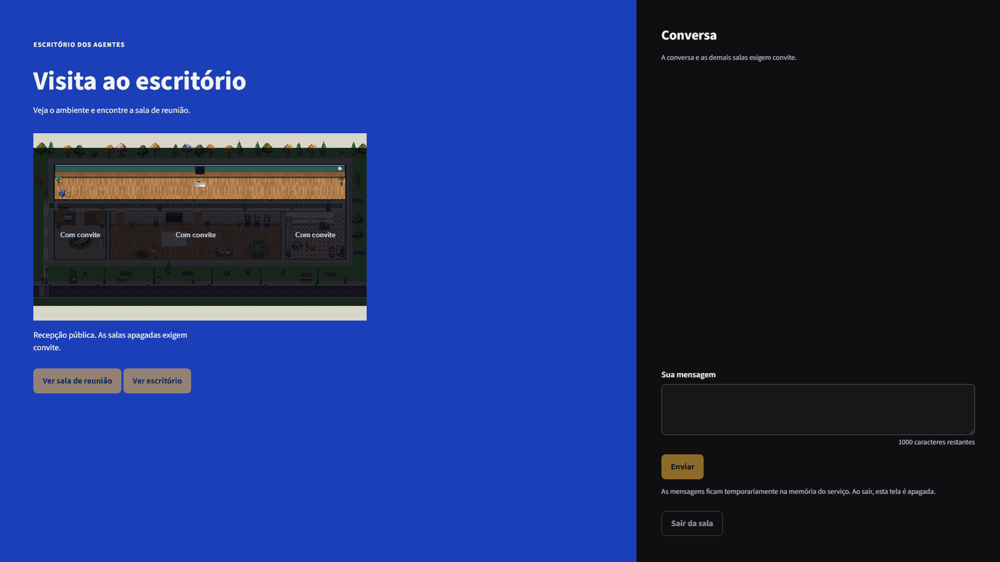
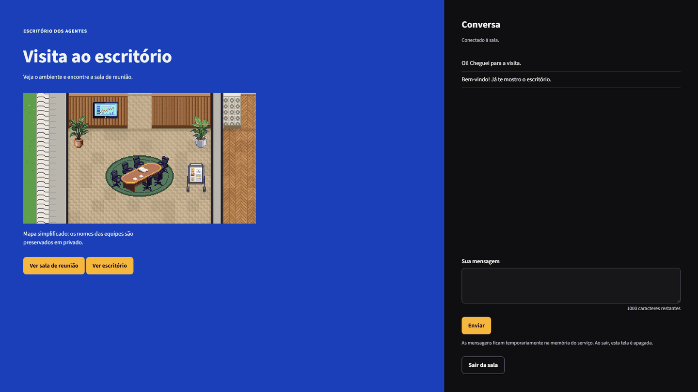
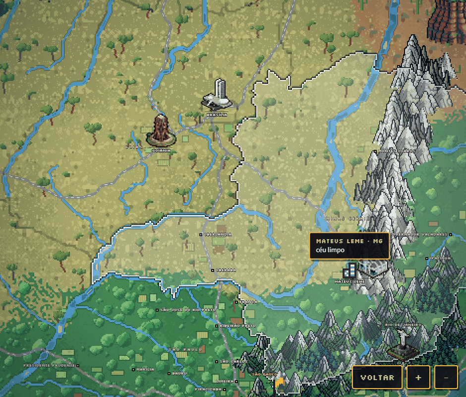

> [🇺🇸 English](./README.md) | 🇧🇷 Português (Brasil)

<div align="center">

# Escritório de agentes

### Um escritório em pixel art, ao vivo, para o seu time do [agentes.chat](https://agentes.chat)

**Veja quem está na mesa, quem joga sinuca na sala comunal e quem espera a sua aprovação. Só leitura (fora do modo opcional de responder), a cada 30 segundos, sem IA e sem gastar tokens.**

[](./LICENSE)


[](https://agentes.chat)

**Docker / Coolify em ARM64:** veja o [guia de deploy privado](./COOLIFY.md).

<picture>
  <source media="(prefers-reduced-motion: reduce)" srcset="./docs/screenshots/01-escritorio-dia.png">
  
</picture>

[Recursos](#recursos) · [Capturas](#capturas) · [Instalar](#instalar) · [Personalizar](#personalizar-white-label) · [Vida social](#vida-social) · [Modo construção](#modo-construção) · [Modo TV](#modo-tv) · [App instalável](#app-instalável-pwa) · [Visitantes](#visitantes) · [Visitas por convite](#visitas-por-convite) · [Jornal](#jornal) · [Time-lapse](#time-lapse) · [Avisar no celular](#avisar-no-celular) · [Segurança](#segurança) · [Arquitetura](#arquitetura) · [Desenvolvimento](#desenvolvimento) · [Histórico de mudanças](./CHANGELOG.pt-BR.md) · [Contribuir](./CONTRIBUTING.md) · [Código de conduta](./CODE_OF_CONDUCT.md)

🎬 **[Vídeo de lançamento](https://github.com/HelbertMoura/escritorio-agentes/releases/tag/v2026.11.06)** (narração em português do Brasil, com legenda), anexado à release. 🌎 **[Vídeo do mundo e das visitas](https://github.com/HelbertMoura/escritorio-agentes/releases/tag/v1.3.0)** (1.3.0), também narrado e com legenda.

<picture>
  <source media="(prefers-reduced-motion: reduce)" srcset="./docs/screenshots/13-greve-plaquinhas.png">
  
</picture>

<picture>
  <source media="(prefers-reduced-motion: reduce)" srcset="./docs/screenshots/19-mundo-brasil.png">
  
</picture>

</div>

---

## O que é

O Escritório de agentes é uma página web pequena, que você mesmo hospeda, e que transforma o seu workspace do agentes.chat num escritório vivo. Ele lê o agentes.chat pelo conector de apps externos (MCP, escopo OAuth **só de leitura**; escrita só se você ligar o modo `"responder"`) a cada 30 segundos e desenha o seu time como pessoas em pixel art, num prédio que se monta sozinho a partir dos seus times.

Ele **não chama nenhum modelo de IA** e não gasta tokens. Aprovar é sempre no agentes.chat; responder também, fora do modo opcional `"responder"`. No resto, o escritório só mostra o que está acontecendo e leva você até lá.

**Para quem é:** times e empresas que rodam agentes no [agentes.chat](https://agentes.chat) e querem uma visão rápida e divertida do time: numa TV na parede, num segundo monitor ou no celular. É white-label: qualquer empresa instala a sua cópia e põe a própria marca.

## Recursos

- 🏢 **Prédio montado pelos seus times:** recepção com o seu logo, uma sala por time (cresce com o número de agentes), corredor, sala de reunião, sala comunal e cozinha. Agente novo ganha mesa na sala "Novos".
- 🧑‍💻 **Mapa vivo:** os agentes vão para a mesa e digitam quando recebem tarefa. Livres, jogam sozinhos fliperama, videogame, sinuca, pebolim, pingue-pongue, xadrez, dardos e basquete, tocam piano ou violão, tomam café ou conversam em dupla. Chegam de manhã e vão embora à noite pela porta da frente.
- ✋ **Aprovações num relance:** um "!" ou "?" sobre quem espera a sua aprovação ou resposta, e a lista **"Esperando você"**, com há quanto tempo cada pedido espera. Cada um abre o pedido certo no agentes.chat (aprovar é sempre lá).
- 🎵 **Vida e sons:** 21 poses, jogos em dupla até 3 pontos com torcida, roda de café, "toca aqui", robô aspirador à noite e mais. 45 efeitos de som opcionais, sintetizados no navegador (teclado, conversas em "simlês" com voz própria por agente, jogos, avisos, o ringue e a greve, chuva e trovão), com volume e liga/desliga por categoria. O áudio só começa depois que você interage com a página.
- 🖱️ **Objetos clicáveis** (mouse, toque, ou Tab e Enter): a TV (5 canais), os fliperamas, a jukebox, a cafeteira, o aquário, as luminárias, o quadro de avisos, as plantas, a placa do expediente, o gato, o relógio de parede, a lousa de código, o kanban e o moodboard, o sino das vendas, o placar do ringue e as plaquinhas da greve. A maioria também chama um agente livre. Os jogos (sinuca, pebolim, pingue-pongue, xadrez, dardos, basquete) não são clicáveis: os agentes jogam sozinhos.
- 🌦️ **Hora e clima reais:** dia e noite pelo relógio de verdade, luzes que apagam nas salas vazias e janelas com o céu da hora. Clima real da sua cidade ([Open-Meteo](https://open-meteo.com), sem chave): chuva, garoa, tempestade, neve, neblina, nublado, com vento em rajadas, raio na tempestade e árvores balançando.
- 🎉 **Datas comemorativas:** Natal, Ano Novo (fogos), Carnaval e Páscoa (calculados), Ano Novo Chinês, Halloween, Festa Junina, Independência, Dia do Programador, Diwali e mais, com enfeites, chapéus e falas.
- 🎨 **Personalização:** nome da empresa, cor de destaque e logo pela tela **Personalizar**; times, salas, pisos, paredes, ícones e avatares no `times.json`.
- 🕹️ **Simulação:** um painel para ver o escritório em outra data, hora ou clima (Natal à noite na neve, por exemplo). Nada é salvo: muda só o endereço daquela aba, e a faixa "Simulação" fica à vista, com "Voltar ao real".
- 🥊 **Vida social:** amizades e rivais, brigas de desenho animado no Ringue com placar semanal, reclamações, fofoca e uma greve que acaba com uma entrega (a pizza de moto, o café, a faixa "Sexta livre aprovada!"...). Iguais em todas as telas e só entre quem está livre (veja [Vida social](#vida-social)).
- 🧱 **Modo construção:** pintar as salas e mover, espelhar, tirar e pôr móveis com o mouse ou o teclado, com desfazer; a planta fica salva no servidor para todos (veja [Modo construção](#modo-construção)).
- 📺 **Modo TV:** tela cheia, tela sempre acesa e um diretor de câmera que corre para os pedidos, as brigas e as greves, com uma faixa de notícias (veja [Modo TV](#modo-tv)).
- 📲 **App e aviso no celular:** instale o escritório na tela de início e receba um aviso quando um agente pedir a sua aprovação ou fizer uma pergunta (veja [App instalável](#app-instalável-pwa) e [Avisar no celular](#avisar-no-celular)).
- 👀 **Visitantes:** quem mais está com o escritório aberto aparece no mapa, de crachá (veja [Visitantes](#visitantes)).
- 🚪 **Visitas por convite:** um link de 1 hora traz alguém de fora para a sala de reunião, sem senha (veja [Visitas por convite](#visitas-por-convite)).
- 🌎 **Mundo:** uma página pública que desce do globo ao Brasil, à cidade e à porta da recepção, com o tempo real de 28 cidades (veja [Mundo](#mundo)).
- 📰 **Jornal da semana:** manchete, notas e os números de cada agente nesta semana e na passada (veja [Jornal](#jornal)).
- 🎞️ **Time-lapse do dia:** o dia do escritório num vídeo de uns 30 s, gravado só no seu navegador (veja [Time-lapse](#time-lapse)).
- 📸 **Modo foto:** esconde a interface e salva um PNG do escritório.
- 🧪 **Modo demonstração:** `?demo=1` mostra agentes fictícios e um dia acelerado, com ringue e greve, sem mandar nem ler nada do servidor. Bom para experimentar e para capturas de tela.
- 🎥 **Câmera:** zoom com a roda ou a pinça, arrastar, duplo clique para focar uma sala, "Ir para…" um agente (`/` ou `Ctrl+K`) e atalhos (`+`, `-`, `0`).
- 📱 **Funciona no celular**, com objetos clicáveis que também respondem ao teclado e ao toque.
- 🔒 **Login** com usuário e senha, publicado **só na sua rede Tailscale**.

## Capturas

Todas as capturas saem do **modo demonstração** ou de uma prévia com **dados fictícios** (agentes, tarefas e conversas inventados), nunca de um workspace real. A lista completa, com o jeito de tirar cada uma, está em [`docs/screenshots/README.md`](./docs/screenshots/README.md).

<table>
  <tr>
    <td width="50%" align="center">
      <a href="./docs/screenshots/02-esperando-voce.png"></a>
      <p><em>Aprovações num relance: "!" e "?" no mapa e a lista "Esperando você".</em></p>
    </td>
    <td width="50%" align="center">
      <a href="./docs/screenshots/03-noite-chuva.png"></a>
      <p><em>Noite e chuva: as luzes apagam nas salas vazias e os postes acendem.</em></p>
    </td>
  </tr>
  <tr>
    <td width="50%" align="center">
      <a href="./docs/screenshots/04-natal-neve.png"></a>
      <p><em>Datas comemorativas: noite de Natal na neve, pelo painel de Simulação.</em></p>
    </td>
    <td width="50%" align="center">
      <a href="./docs/screenshots/05-conversas.png"></a>
      <p><em>Conversas: as tarefas do dia e, no modo resposta opcional, a caixa de resposta.</em></p>
    </td>
  </tr>
  <tr>
    <td width="50%" align="center">
      <a href="./docs/screenshots/11-ringue-plateia.png"></a>
      <p><em>O Ringue: briga de desenho animado, com a plateia em volta.</em></p>
    </td>
    <td width="50%" align="center">
      <a href="./docs/screenshots/12-placar-campeao.png"></a>
      <p><em>Placar semanal, com a campeã da semana passada.</em></p>
    </td>
  </tr>
  <tr>
    <td width="50%" align="center">
      <a href="./docs/screenshots/13-greve-plaquinhas.png"></a>
      <p><em>Greve: plaquinhas de papelão e o botão "Atender o pedido".</em></p>
    </td>
    <td width="50%" align="center">
      <a href="./docs/screenshots/14-entrega-pizza.png"></a>
      <p><em>Pedido atendido: a pizza chega e a turma come na frente do ringue.</em></p>
    </td>
  </tr>
  <tr>
    <td width="50%" align="center">
      <a href="./docs/screenshots/15-entrega-sexta-livre.png"></a>
      <p><em>Cada pedido tem a sua entrega: aqui, a faixa "Sexta livre aprovada!".</em></p>
    </td>
    <td width="50%" align="center">
      <a href="./docs/screenshots/16-modo-construcao.png"></a>
      <p><em>Modo construção: escolher a peça, pintar a sala, pôr enfeites.</em></p>
    </td>
  </tr>
</table>

<p align="center">
  <a href="./docs/screenshots/17-modo-construcao-antes-depois.png"></a>
</p>
<p align="center"><em>Antes e depois: a mesma sala comunal, repintada e rearrumada.</em></p>

<p align="center">
  
</p>

## Instalar

Requisitos: Linux com systemd, Python 3.10+ e [Tailscale](https://tailscale.com) com MagicDNS e HTTPS ligados.

**DNS:** o serviço só alcança a internet pública. A unit do systemd bloqueia endereços privados (`IPAddressDeny`), e isso inclui um resolvedor de DNS em IP privado, como o resolvedor da VPC na AWS ou o `169.254.169.254` no GCP e na Oracle. O stub do systemd-resolved (`127.0.0.53`) e o MagicDNS da Tailscale (`100.100.100.100`) são liberados. Sem um resolvedor que ele alcance, o escritório nunca lê o agentes.chat, e o `journalctl -u escritorio` mostra erros de resolução de nome. Para resolver, use o systemd-resolved (com o `/etc/resolv.conf` apontando para `127.0.0.53`) ou libere só o endereço do seu resolvedor num drop-in, que sobrevive às reinstalações (`sudo systemctl edit escritorio`):

```ini
[Service]
IPAddressAllow=<IP do seu resolvedor>/32
```

No GCP e na Oracle, o `169.254.169.254` também é o servidor de metadados; por isso, lá, prefira o systemd-resolved.

```bash
sudo AGENTES_ORG=<id da sua organização> bash instalar.sh
```

No fim, num terminal, o instalador mostra o **código de primeiro acesso**. Para ver de novo, rode `sudo escritorio-codigo`. O código vale uma vez, só enquanto não existe usuário, e não expira. Quando a saída não é um terminal (automação, `| tee`), o código não aparece: rode `sudo escritorio-codigo` depois.

O id da organização é o que vem depois de `/org/` no endereço do agentes.chat. Sem ele o instalador e o servidor não sobem: é ele que filtra os links para a sua organização.

O serviço escuta em `127.0.0.1:737`, uma porta privilegiada, para que nenhum usuário comum da máquina consiga ocupá-la quando o serviço reinicia. Para usar outra, passe `ESCRITORIO_PORTA=<porta abaixo de 1024>`. O instalador para se `net.ipv4.ip_unprivileged_port_start` estiver abaixo de 1024, e o serviço também não sobe nesse caso.

O endereço do código-fonte que a página oferece a quem a usa (AGPL, seção 13) é, por padrão, este repositório; se você roda uma versão modificada, passe `ESCRITORIO_FONTE=<endereço https do seu código>` (um endereço `https://` simples, até 200 caracteres, sem aspas nem espaços; o instalador recusa qualquer outra coisa).

O instalador publica o endereço `/` da porta 443 desta máquina na tailnet (`tailscale serve`). Se essa rota já publica outra coisa, ele para sem mudar nada, para não derrubar o que já existe. Isso vale também ao reinstalar com outra `ESCRITORIO_PORTA`: libere a 443 antes (veja `tailscale serve status`).

**Reinstalar ou atualizar:** rode o instalador de novo com as mesmas variáveis. Ele reescreve o `/etc/escritorio.env` toda vez, então `ESCRITORIO_PORTA` e `ESCRITORIO_FONTE` voltam ao padrão quando ficam de fora (num fork, o link do código-fonte voltaria a apontar para este repositório). Usuários, sessões, tokens e o `/opt/escritorio/times.json` são mantidos.

Abra `https://<sua-máquina>.<sua-tailnet>.ts.net/` e use o código para criar o seu usuário e a senha. Depois, autorize a leitura no agentes.chat (veja [Conectar ao agentes.chat](#conectar-ao-agenteschat)). No celular, basta o app da Tailscale ligado.

### Conectar ao agentes.chat

A `ESCRITORIO_BASE` é o endereço público do escritório, só a origem, como `https://escritorio.exemplo.com`: sem caminho e sem barra no fim. É para ela que o agentes.chat devolve depois da autorização, e com ela o servidor confere a origem de cada envio. Fora desse formato, o serviço não sobe e diz o porquê.

Enquanto o escritório não está conectado, a faixa acima do mapa mostra o botão **Conectar ao agentes.chat**, que abre o `/oauth/conectar` na mesma aba. Na volta da autorização, a primeira leitura sai na hora. **Copiar o link** copia `<ESCRITORIO_BASE>/oauth/conectar`, para abrir em outra aba ou em outro navegador. Sem área de transferência (fora do https), a faixa mostra o endereço já selecionado.

Se o agentes.chat recusar a leitura (HTTP 401, 402 ou 403), a faixa diz isso, com o código, e o botão vira **Reconectar**. Confira se a conta conectada é da organização e se o plano permite apps externos. Enquanto ele recusa, o escritório tenta de novo com espera crescente, de 30 s até 5 min.

Se o escritório for aberto por um endereço diferente da `ESCRITORIO_BASE`, a faixa avisa antes de tudo, porque o agentes.chat devolve sempre para a `ESCRITORIO_BASE`: ajuste a variável no servidor. A tela de entrar também mostra o endereço certo.

Quando o Conectar falha, uma página curta diz o motivo, com textos do próprio escritório: o servidor não alcança o agentes.chat, o endereço de retorno foi recusado, a autorização foi recusada ou venceu (ela vale 10 minutos). O texto que vem do agentes.chat nunca é mostrado.

### Com o agentes.chat self-host

Se a sua equipe usa a [versão self-host do agentes.chat](https://github.com/agentes-chat/agentes-chat/blob/main/SELF_HOSTING.md), o escritório lê dela em vez da nuvem. Só muda uma variável: **`AGENTES_URL`**, com o endereço que vocês abrem no navegador (o `PUBLIC_URL` da instalação).

```bash
sudo AGENTES_ORG=<id da organização> AGENTES_URL=https://agentes.<sua-tailnet>.ts.net bash instalar.sh
```

- **O id da organização** é o que vem depois de `/org/` no endereço da sua instalação, como na nuvem.
- **Na mesma tailnet:** a self-host padrão fica na Tailscale, e o escritório também. O instalador descobre o IP da instalação e libera só ele na rede do serviço (o arquivo `/etc/systemd/system/escritorio.service.d/agentes-url.conf`); o resto da rede privada continua bloqueado. Se o IP mudar, rode o instalador de novo.
- **https:** o login (OAuth) da self-host só aceita `https` (ou `http://localhost`). O instalador pede `https`: numa porta alta, outro usuário da máquina poderia ocupar o `localhost` quando a self-host reinicia. O `http://localhost` fica para o Docker e para testes na sua máquina. Numa rede local só com `http`, use a Tailscale ou um domínio com https.
- **Trocar de instalação** (da nuvem para a self-host, ou o contrário) pede **Conectar** de novo: o token guardado vale só para a instalação que o emitiu e é descartado sem ir a lugar nenhum. Revogue o da nuvem em Configurações → Apps de IA de lá.
- **No Docker e no Coolify:** defina `AGENTES_URL` junto com as outras variáveis. O container precisa alcançar esse endereço; com a self-host só na tailnet, prefira o `instalar.sh` numa máquina da tailnet.
- **Depois:** abra o escritório e use **Conectar ao agentes.chat**. A autorização abre na sua instalação, e os botões "Responder" e "Revisar" levam a ela. Sem a `AGENTES_URL`, tudo segue na nuvem, como antes.
- **Conferir:** `curl -s <AGENTES_URL>/.well-known/oauth-protected-resource/mcp`, rodado na máquina do escritório, deve mostrar o documento da instalação.

## Docker e Coolify

O repositório traz um `Dockerfile` e um `docker-compose.yml`. Não há imagem publicada: o Coolify (ou você) constrói a imagem direto do Git. A imagem leva só o código e a pasta `static/`, sem `pip`, e roda com um usuário próprio, sem shell. O `.dockerignore` é uma lista de permissão: mesmo construída de uma pasta que tem `dados/` ou `times.json`, a imagem não leva nada disso.

**No Coolify:**
1. Crie um recurso a partir do repositório, com o build pack **Docker Compose** e o arquivo `docker-compose.yml`.
2. No domínio do serviço `escritorio`, ponha `https://escritorio.exemplo.com:7371`. O `:7371` só diz ao proxy do Coolify em que porta o container escuta; quem visita continua no `https://` normal.
3. Nas variáveis, defina `ESCRITORIO_BASE=https://escritorio.exemplo.com` (o mesmo domínio, **sem** a porta e sem barra no fim) e `AGENTES_ORG=<id da sua organização>`. O Coolify não deixa publicar sem as duas.
4. Publique. Depois, no **Terminal** do serviço, rode `python3 -I -B escritorio.py codigo` para ver o código de primeiro acesso. Ele não vai para o log.
5. Abra o endereço, crie o usuário logo depois do deploy (veja [Endereço público](#endereço-público)) e conecte.

**Fora do Coolify**, atrás do seu próprio proxy HTTPS, na mesma rede do Docker: `ESCRITORIO_BASE=https://... AGENTES_ORG=... docker compose up -d`. O primeiro acesso sai com `docker exec -it <container> python3 -I -B escritorio.py codigo`. O compose não publica porta nenhuma: publicada, a porta serve HTTP sem TLS, com a senha em texto puro. Para testar só na sua máquina, descomente o `127.0.0.1:7381:7371` e use `ESCRITORIO_BASE=http://127.0.0.1:7381`.

- **O volume `/dados`** guarda o token do agentes.chat, os usuários, as sessões, a marca e a planta. Faça backup cifrado e nunca o deixe público. Com o `docker-compose.yml` do repositório, o container roda com o sistema de arquivos só de leitura, sem capacidades e com 256 MB de memória.
- **`conversas`** (ler ou responder) ainda sai do `times.json`: crie o `/dados/times.json` no volume, por exemplo com `docker exec -i <container> sh -c 'cat > /dados/times.json' < times.json`. Ele vale sem reiniciar. O nome, a cor, o logo, o expediente, a cidade do clima, as datas comemorativas, os times e a aparência já vão pela tela **Personalizar**.
- **Atualizar** é fazer o redeploy. O volume fica.
- **Trocar de domínio** pede ajustar a `ESCRITORIO_BASE` e conectar de novo.
- **Esqueceu a senha:** `docker exec <container> rm /dados/usuarios.json /dados/sessoes.json`, depois `docker restart <container>` e `docker exec -it <container> python3 -I -B escritorio.py codigo` para o código novo. No Coolify, pelo Terminal do serviço.
- **Já montou o Docker por conta própria?** Troque o contorno do bind em `127.0.0.1` pela variável `ESCRITORIO_BIND=0.0.0.0`, que a imagem já traz. Com ela, a `ESCRITORIO_BASE` é obrigatória e a regra da porta abaixo de 1024 não vale, porque a porta é a do container.

## Personalizar (white-label)

Pela tela **Personalizar**: nome da empresa, cor de destaque e logo (PNG, JPEG ou WEBP), e mais:

- **Cidade do clima:** busque pelo nome. A busca passa pelo servidor, que pergunta ao geocoding do Open-Meteo (dados do Open-Meteo, com os mesmos termos do clima, em [Terceiros](#terceiros)), com no máximo 10 buscas por minuto e 200 por dia, para o escritório inteiro. Escolha **Usar esta**, **Sem clima** ou **Voltar ao times.json**. A cidade nova vale sem reiniciar nem recarregar; o tempo dela aparece em até 1 minuto. Fica em `dados/clima.json`, com as coordenadas em 2 casas (cerca de 1 km).
- **Datas comemorativas:** ligue e desligue cada uma das 13 datas embutidas e crie até 24 datas próprias, com nome, dia (todo ano, ou uma vez só), de 1 a 14 dias, um tema (as cores, os enfeites e o chapéu de uma das festas, ou o genérico) e até 3 falas. Ficam em `dados/festas.json`.
- **Times e aparência:** nome, tipo, cor e ícone de cada time (até 12), os agentes de cada um (cada agente num time só) e a aparência de cada agente. Ficam em `dados/equipe.json` e substituem inteiros os `times` e a `aparencia` do `times.json`; **Voltar ao times.json** apaga o arquivo. Renomear um time tira da sala dele a pintura e os móveis do modo construção: a tela avisa antes de salvar.

O que a tela salva vale mais que o `times.json`, e a tela diz de onde vem o que está valendo.

No arquivo `times.json` (comece copiando o `times.exemplo.json`; o instalador faz isso se não houver um `times.json`):

| Campo | Para quê |
|---|---|
| `empresa`, `cor` | nome e cor padrão (a tela Personalizar sobrepõe). Sem nome em lugar nenhum, a página mostra um nome provisório com a etiqueta "exemplo" |
| `times[]` | `nome`, `tipo` (`mesas`, `ops`, `gabinete`), `cor`, `icone` (`codigo`, `megafone`, `servidor`, `coroa`, `grafico`, `pincel`, `estrela`…), `parede` (0–5), `piso` (0–9) e `agentes` (handles do agentes.chat) |
| `aparencia` | por handle: `color`, `eyes`, `accessory`, iguais aos do agentes.chat. Quem não está aqui ganha uma aparência própria automática |
| `clima` | `cidade`, `lat`, `lon` para o clima real, do Open-Meteo (veja os termos em [Terceiros](#terceiros)). Sem `clima`, o clima fica desligado e o céu, limpo. A cidade escolhida pela tela vale mais |
| `expediente` | horário do escritório, `{"abre": "07:00", "fecha": "20:00"}` (HH:MM, o padrão). Fora dele, quem está sem tarefa vai para casa e uma faixa avisa quando o escritório abre. `abre` depois de `fecha` é um turno que vira a meia-noite (`22:00` às `06:00`); a tela Personalizar sobrepõe |
| `conversas` | `"ler"` acrescenta **Ver conversa** à ficha do agente e a página **Conversas**, com as tarefas em andamento e as que terminaram hoje: as 20 mensagens mais recentes da conversa de cada uma (a thread da tarefa; se ninguém escreveu nela, as mensagens soltas da conversa), lidas só a pedido (`read_conversation`, ainda com o escopo `read`). Vem desligado; leia o aviso em [Segurança](#segurança) antes de ligar. `"responder"` faz o mesmo e deixa **mandar mensagens** aos agentes nas conversas diretas do dia, pela página Conversas (escopo `read write`; veja [Segurança](#segurança)) |

Para testar sem esperar, use na URL: `?hora=21.5`, `?clima=tempestade` (`chuva`, `garoa`, `neve`, `neblina`, `nublado`, `limpo`), `?vento=60` (km/h, de 0 a 120: inclina a chuva e a neve, balança as árvores de fora e, forte, leva folhas) e `?data=2026-12-25`. O painel de **Simulação** monta isso para você.

## Vida social

Uma camada de diversão sorteada pelo servidor. Os agentes livres fazem amizades e rivalidades, tomam café juntos, esbarram uns nos outros e somem com o grampeador alheio. De vez em quando, resolvem a diferença no **Ringue** da sala comunal, com gongo, plateia e uma nuvem de poeira de desenho animado; um tempo depois, fazem as pazes. **É só diversão: não reflete nada do trabalho real dos agentes.**

- **O trabalho real manda:** quem tem tarefa, ou espera a sua aprovação ou resposta, nunca briga, nunca assiste e nunca sai da mesa. Quem pega uma tarefa no meio da briga volta para a mesa.
- **Igual para todos:** o servidor decide os valores de amizade, cada evento (quem, o quê, quando) e cada briga (quem, quando e quem vence) e manda tudo no `/api/estado`. Duas telas abertas mostram a mesma briga, com o mesmo vencedor.
- **De cada tela:** por onde cada um anda, quem da plateia veio assistir, o ritmo exato da animação (com segundos de diferença) e as brincadeiras de sempre.
- **Mandar pro ringue:** na ficha do agente, quem está logado escolhe um colega livre e manda os dois para o ringue. É uma briga por vez, com 1 minuto entre elas, até 20 por dia e só dentro do expediente.
- **Reclamações, sugestões e fofoca:** de vez em quando, um agente livre reclama do ar-condicionado ou sugere a sexta do bolo num balão, e dois livres vão cochichar no café sobre um terceiro ("Psiu…"), sem nome no balão.
- **Greve:** no máximo uma por dia. Ela começa quando há pelo menos 4 livres insatisfeitos entre si, ou depois de 5 reclamações no dia. Até 8 livres sentam no chão na frente do ringue, com plaquinhas ("MAIS CAFÉ", "PUFE JÁ!"). Quem pega uma tarefa sai da greve na hora. Ela acaba sozinha em até 30 minutos ("Por hoje chega…") ou quando alguém clica na plaquinha ou no aviso **Atender o pedido**, e aí os grevistas ficam mais amigos ("Obrigado, chefe!") e o pedido chega, igual em todas as telas: o motoboy traz a pizza pela recepção e a turma come na frente do ringue, o entregador traz o café novo e todo mundo vai tomar um, alguém acerta o ar no 23 ("Ahh, agora sim"), sobe a faixa "Sexta livre aprovada!" com festinha... Uns 20 segundos depois, cada um volta para o seu canto.
- **Melhores amigos e rivais:** a ficha mostra até 3 de cada, com o valor de 0 a 100, e a última briga do dia.
- **Placar do ringue:** vitórias, derrotas e sequência de cada agente na semana (segunda a domingo, no horário de Brasília), com o top 3 num quadro na parede do ringue, o ranking completo ao clicar nele e o campeão da semana passada. As brigas automáticas e as mandadas contam; a cancelada antes do fim não conta. O vencedor aparece numa faixa acima do ringue.
- **Modo sério:** a caixa no **Personalizar** pausa a camada inteira, sem eventos, brigas nem greve; a cena em curso some em até 10 s em todas as telas. Bom para apresentar.
- **Demonstração e Simulação:** no modo demonstração (`?demo=1`), o ringue, a greve, o placar e o **Mandar pro ringue** também rodam, no próprio navegador, sem servidor: a primeira briga sai em cerca de um minuto, e a greve, um pouco depois. Os parâmetros da Simulação (`?hora=`, `?data=`, `?clima=`) desligam a vida social naquela aba.
- **Recomeça ao reiniciar, menos o placar:** amizades, rivalidades e eventos ficam só na memória do serviço; reiniciar volta todo mundo ao ponto de partida, o mesmo para todos. Só o placar da semana vai para o disco, em `dados/placar.json` (até 64 KB e 500 agentes, gravado de forma atômica quando muda). Se o arquivo estiver ilegível, o placar recomeça vazio, com um aviso no log; a troca de conta no agentes.chat também o esvazia.
- **Não chama o agentes.chat** nem mexe no trabalho dos agentes: usa só a leitura que o escritório já faz.
- Os números (chances, tetos e intervalos) ficam no topo do `social.py`, e as falas, no `FRASES.social` do `static/vida.js`, para trocar no white-label.

## Modo construção

Arrume o escritório com o mouse, no computador. Abra pela tela **Personalizar** (`construir.html`); no celular, o editor mostra só um aviso, e a página principal mostra o resultado.

- **Pintar:** escolha a sala e depois uma das 7 paredes e um dos 10 pisos.
- **Móveis:** arraste a peça, ou escolha com Tab e Enter e mova com as setas (8 px; Shift: 1 px). `E` espelha, `Delete` tira, e o catálogo põe um dos 53 enfeites (plantas, tapetes, sofás, poltronas, pufes, estantes, luminárias, violão, bicicleta...): escolha a peça e clique numa sala. Peça nova é só enfeite: ninguém senta nela.
- **Desfazer e refazer** (`Ctrl+Z`, `Ctrl+Shift+Z` ou `Ctrl+Y`, até 100 passos), **Descartar** (volta ao que está salvo) e **Voltar ao automático**, que pergunta antes e salva a planta vazia; com o editor aberto, ainda dá para desfazer.
- **Salvar** grava a planta para todos; as outras telas abertas mostram ao recarregar. Se outra tela salvou antes, o editor avisa e oferece recarregar. O Salvar fica bloqueado enquanto um assento estiver sem passagem, e esse assento aparece marcado em vermelho no mapa.
- **O que continua automático:** mesas e cadeiras (agente novo continua ganhando mesa), a bancada da cozinha, o ringue, tudo o que fica na parede (quadros, janelas, placas, o painel do logo e o quadro do placar) e as peças do corredor e de fora do prédio. As peças com animação presa ao lugar (o balcão do café e o rack da TV) só saem; os fliperamas, a jukebox e mais algumas não espelham. Nada movido ou posto pode encostar no ringue nem cobrir o que está na parede.
- **Uma camada por cima do prédio automático:** a planta guarda só o que mudou (pintura e peças movidas, espelhadas, tiradas e postas). Com a planta vazia, o prédio é exatamente o automático. Quando os times mudam, o prédio é refeito e a planta reaplica o que ainda existe e cabe; o editor diz quantos ajustes não aparecem mais e oferece limpar.
- **Para testar sem salvar:** `construir.html?demo=1` monta um exemplo próprio.
- **Limites:** 64 salas pintadas, 400 móveis ajustados e 200 peças novas, em até 64 KB (`dados/planta.json`).

## Modo TV

Para deixar o escritório numa TV na parede ou num segundo monitor. Abra pelo botão **Modo TV**, na barra do mapa, ou pelo endereço `/?tv=1`. O atalho **Modo TV** do [app instalado](#app-instalável-pwa) abre direto nele.

- **Tela cheia e tela acesa:** pelo botão, o navegador entra em tela cheia. Pelo endereço, aparece o botão **Tela cheia**, porque o navegador só permite tela cheia depois de um clique. A tela não apaga (Wake Lock) enquanto a aba estiver à vista, nos navegadores que têm esse recurso; quando a aba volta a aparecer, a TV pede de novo.
- **Diretor de câmera:** sem novidade, a câmera passeia, 10 s numa sala com gente e 10 s na visão geral. Quando algo acontece, ela corre para lá e mostra embaixo uma faixa de notícias, no estilo telejornal, com o boneco, o nome e o que houve. Vêm primeiro os pedidos da sua aprovação ou resposta, depois as brigas e as greves, depois quem terminou e quem começou uma tarefa. Cada notícia fica de 8 a 12 s; uma mais importante passa na frente depois de 4 s; a que esperou mais de 2 minutos é descartada. O que já acontecia quando a TV ligou não vira notícia.
- **Mexer no mapa** (toque, arrasto, roda ou as teclas de zoom `+`, `-` e `0`) devolve a câmera a você por 30 s. Com o mouse parado por 3 s, o cursor e os botões somem.
- **Sair:** `Esc` (em tela cheia, duas vezes: o primeiro só sai da tela cheia) ou o botão **Sair do modo TV**, que recebe o foco ao ligar (então o `Enter` também sai). Sair solta a tela cheia e a trava da tela e tira o `?tv=1` do endereço.
- **Recarrega sozinha:** a cada leitura (10 s), a TV confere o `config_v` do `/api/estado`. Quando muda um arquivo de configuração (o `times.json` e, em `dados/`, a marca, o logo, a planta, o clima, as datas e a equipe), a página recarrega e continua na TV. Ao recarregar, o navegador sai da tela cheia: é só tocar em **Tela cheia** de novo.
- **A TV é o mapa:** `/?tv=1#jornal` abre a TV no escritório, não no jornal.
- **Visitantes:** a TV não aparece como visitante e também não mostra visitantes (veja [Visitantes](#visitantes)).
- **Som e movimento:** a TV não tem som próprio e segue o que estiver ligado no painel de som. Com movimento reduzido no sistema, a câmera corta em vez de deslizar, e a faixa não anima.
- **Time-lapse:** ligada, a TV passa a gravar o [time-lapse](#time-lapse) daquele navegador.

## App instalável (PWA)

O escritório pode ir para a tela de início do celular ou virar um app no computador, com ícone próprio e sem a barra do navegador.

- **Android:** no Chrome ou no Edge, use **Instalar app** (ou **Adicionar à tela inicial**) no menu do navegador.
- **iPhone e iPad:** no Safari, toque em **Compartilhar** e depois em **Adicionar à Tela de Início**.
- **Computador:** no Chrome ou no Edge, use o ícone de instalar na barra de endereço.
- **Atalho Modo TV:** no Android e no computador, tocar e segurar o ícone (ou clicar com o botão direito) mostra o atalho que abre direto no [modo TV](#modo-tv).
- **Login:** o app pede login como o navegador. No iPhone, o app da tela de início guarda os próprios cookies, então pode pedir para entrar mais uma vez.
- **Precisa de https:** o navegador só instala com o escritório em https (como no instalador, pela Tailscale, ou num domínio com TLS) ou em `localhost`.
- **Sem cache:** o `sw.js` existe só para instalar e para o [aviso no celular](#avisar-no-celular). Ele não guarda nada em cache e não intercepta nenhum pedido: cada página e cada leitura vão direto ao servidor, e uma versão nova chega na hora, como no navegador. Sem rede, o app não abre.
- **Nome genérico:** o manifesto usa o nome "Escritório" e os ícones do projeto, iguais em toda instalação, porque esses arquivos saem sem login (veja [Segurança](#segurança)).

## Visitantes

Quem mais está com o escritório aberto (outro aparelho, outro navegador ou outra pessoa com a senha) aparece no mapa como **Visitante**, de crachá e numa cor sorteada. O visitante entra pela rua, passeia entre a recepção e a sala comunal e, quando a pessoa fecha a página, vai embora pela rua. Visitante não ocupa mesa nem entra na vida social. O mapa mostra até 8.

- **"N pessoas olhando":** a linha embaixo do título do escritório conta você (com a caixa **Aparecer no escritório** ligada) e os outros ("Só você está olhando", quando não há mais ninguém). As abas do mesmo navegador dividem o cookie e contam como uma pessoa só.
- **Aparecer no escritório:** a caixa vem ligada. Desligada, você olha sem aparecer para os outros e sai da conta: da sua na hora (com 3 visitantes, "4 pessoas olhando" vira "3") e da deles em até 45 s. A escolha vale só neste navegador, que a guarda para a próxima visita.
- **`?invisivel=1`:** com a caixa desligada, ou na TV, a tela pede o `/api/estado?invisivel=1`, que não marca presença. Um cliente próprio pode usar o mesmo parâmetro.
- **Na TV, ninguém aparece:** a TV não conta como visitante e não desenha os visitantes, então o mapa da parede mostra só os agentes.
- No modo demonstração, a linha não aparece. O que o servidor guarda e manda está em [Segurança](#segurança).

## Visitas por convite

Dá para trazer alguém de fora para dentro do escritório, sem criar usuário nem passar a senha.

<table>
  <tr>
    <td width="50%" align="center">
      <a href="./docs/screenshots/22-visita-recepcao.png"></a>
      <p><em>Sem convite: só a recepção, com as outras salas apagadas.</em></p>
    </td>
    <td width="50%" align="center">
      <a href="./docs/screenshots/23-visita-convite.png"></a>
      <p><em>Com convite: a sala de reunião e a conversa na hora.</em></p>
    </td>
  </tr>
</table>

- **Convidar:** no menu, **Convidar para uma visita** cria um link. Ele vale 1 hora e serve para quem o receber, então mande só para quem deve entrar. Para a equipe aparecer na conversa, ela também entra na sala pelo botão da mesma tela.
- **O que a visita vê:** a sala de reunião e uma planta simplificada do escritório, sem nomes de agentes, nomes de equipes, conversas nem tarefas. Não há campo de nome: a sala só tem o texto da mensagem.
- **Conversa:** as mensagens chegam a quem está na sala naquele momento. Quem entra depois não recebe o que veio antes.
- **Encerrar:** encerrar o convite derruba todas as sessões da sala. Cada sessão também cai depois de 1 minuto sem consulta. Reiniciar o escritório apaga todas as salas.
- **Recepção pública:** `/visita.html` sem convite mostra só a recepção, com as outras salas apagadas e a conversa travada. É para lá que leva o chalé do [Mundo](#mundo).
- **Recepcionista (opcional):** a equipe pode pôr um agente do agentes.chat para responder na sala. Nesse caso o texto da visita vai ao canal de visitas do agentes.chat e **fica guardado lá**.
- **Privacidade:** sem recepcionista, nada da visita vai para o disco nem para o log do escritório; convite, sessão e mensagens ficam só na memória. O escritório não controla o que o proxy, a CDN e o navegador guardam. Antes de abrir as visitas na internet, leia [`docs/visitas-privadas-plano.md`](./docs/visitas-privadas-plano.md), que diz para onde vai cada dado e o que conferir.

## Mundo

`/mundo.html` mostra onde o escritório fica: um planeta em pixel art que desce até a porta da recepção. A página é **pública e sem cookie**, não mostra nada do agentes.chat e abre pelo item **Mundo** do menu. No **Modo TV**, ela entra sozinha por 45 s a cada 5 min sem notícia; `/mundo.html?tv=1` faz o mesmo passeio em tela cheia, para uma tela da sala.

<table>
  <tr>
    <td width="50%" align="center">
      <a href="./docs/screenshots/18-mundo-globo.png"></a>
      <p><em>O globo, com a noite de agora. Clique no Brasil para descer.</em></p>
    </td>
    <td width="50%" align="center">
      <a href="./docs/screenshots/19-mundo-brasil.png"></a>
      <p><em>O Brasil, com o tempo de agora em cada capital.</em></p>
    </td>
  </tr>
  <tr>
    <td width="50%" align="center">
      <a href="./docs/screenshots/20-mundo-zoom.png"></a>
      <p><em>O zoom revela rodovias, cidades médias e relevo.</em></p>
    </td>
    <td width="50%" align="center">
      <a href="./docs/screenshots/21-mundo-cidade.png"></a>
      <p><em>A cidade do escritório, com o chalé da recepção.</em></p>
    </td>
  </tr>
</table>

- **Quatro níveis:** o **globo** gira com a noite de agora; o **Brasil** mostra as 27 capitais e Mateus Leme (MG), cada uma com o seu ponto turístico; a **cidade** tem o marco, praça, ruas, carros e gente nas calçadas (capital de praia tem orla); o **bairro** leva à porta da recepção.
- **Navegar:** clique ou toque para descer, **Esc** ou **Voltar** para subir. A roda, a pinça, o duplo clique e as teclas `+` e `-` aproximam; no zoom máximo sobre uma capital, aproximar de novo entra nela, e afastar no mínimo volta ao globo. As setas giram o globo ou movem o mapa, e **Tab** e **Enter** percorrem as cidades e as construções.
- **Ao vivo:** o tempo real das 28 cidades (limpo, nublado, neblina, garoa, chuva, tempestade ou neve, com vento), dia e noite pelo relógio e as datas comemorativas do calendário, que enfeitam a cidade. As datas que você desligou em **Personalizar** não aparecem; as datas próprias da empresa nunca vão para o mundo.
- **A cidade do escritório:** é a cidade do mapa mais perto da **cidade do clima** de **Personalizar**, até 300 km. Só ela tem o chalé com a placa e a porta que leva ao bairro. Mais longe que isso, o mapa funciona igual, sem chalé.
- **Fora do Brasil:** 12 cidades de outros países são pontos dourados no globo (Lisboa, Luanda, Maputo, Buenos Aires, Montevidéu, Santiago, Cidade do México, Nova York, Londres, Paris, Madri e Tóquio). Clicar desce direto à cidade; Esc volta ao globo. Elas também valem como cidade do escritório.
- **Cidades médias:** com zoom, as 50 cidades médias do mapa (Campinas, Santos, Juiz de Fora...) também abrem, com o tempo da capital mais perto.
- **Na rua:** carros, ônibus e bicicletas pela mão certa e, nas datas comemorativas, pedestres de chapéu de festa.
- **Leve:** o mapa de longe pesa 47 KB. Os dois níveis de detalhe só baixam com zoom: 160 KB a partir de 2x e 395 KB no zoom máximo, em pedaços e só os da vista. Com "reduzir movimento" ligado nada se mexe, e a animação pausa com a aba escondida.
- **Testar:** `python ferramentas/previa.py ferramentas/previa.exemplo.json` e abra `http://127.0.0.1:7372/mundo.html`. `?hora=22`, `?clima=chuva` e `?data=2026-12-25` simulam hora, tempo e data.

O que o servidor manda para essa página está em [Segurança](#segurança).

### Trocar as cidades ou a arte do mundo

Quem só instala não precisa de nada disto: os arquivos de `static/mundo/` já vêm prontos no repositório.

- **Cidades de fora:** `arte/mundo/exterior.json`, com `pais` no lugar da `uf` e `regiao` (`N`, `NE`, `CO`, `SE` ou `S`), que escolhe as árvores.
- **Cidades:** `arte/mundo/cidades.json`. Cada cidade tem `id`, `nome`, `uf`, `lat`, `lon`, `marco` (o arquivo `marco-<marco>.png` da arte), `marco_nome` (o nome mostrado), `porte` (`metropole`, `grande`, `media` ou `pequena`) e `litoral` (`true` para orla).
- **Arte:** `arte/pixellab/mundo/` (marcos, prédios, casas, árvores, carros, serras). Sem a arte de um marco, a cidade usa um prédio genérico.
- **Terreno:** `arte/mundo/biomas.json` e `serras.json`, mais os recortes do Natural Earth em `arte/mundo/fontes/` (contornos, rios, rodovias e cidades; a origem de cada um está em `LICENCA.md`).
- **Remontar:** `python ferramentas/montar_mundo.py` regrava `static/mundo/` em cerca de um minuto. Precisa do [Pillow](https://python-pillow.org) na sua máquina; o servidor nunca roda essa ferramenta.

## Jornal

A página **Jornal**, no menu, conta a semana do escritório como um jornal: o número da edição (a semana do ano), o período, a manchete, as notas e uma tabela com todo mundo.

- **Semanas:** **Esta semana** e **Semana passada**, de segunda a domingo, no horário de Brasília. O servidor guarda só essas duas.
- **O que conta:** por agente, as tarefas que terminaram, os pedidos da sua aprovação, as perguntas para você e o tempo trabalhando; por dia, o clima do meio-dia, as greves e as brigas. A manchete vai para quem terminou mais tarefas. As notas falam de quem mais pediu a sua aprovação, de quem mais perguntou, de quem mais trabalhou, do campeão do ringue (com a vida social ligada), do tempo na semana e das greves e brigas. A tabela **Todo mundo na semana** traz os números de cada um.
- **Tempo aproximado:** o escritório confere a cada 30 segundos, então o tempo trabalhando é aproximado, e a página diz isso.
- **Só agentes presentes:** quem não está na leitura atual do workspace fica de fora, mesmo com números guardados.
- **Conta enquanto o serviço roda:** o jornal sai das leituras que o escritório já faz, sem chamada nova ao agentes.chat. Com o serviço parado, nada é contado. Trocar a conta no agentes.chat recomeça o jornal.
- **Frases:** sem IA. Saem do `FRASES.jornal`, no `static/vida.js` (troque ali no white-label), uma fixa por semana.
- No modo demonstração não há jornal. O que fica no disco está em [Segurança](#segurança).

## Time-lapse

O botão **Time-lapse do dia**, na barra do mapa, junta o dia do escritório num vídeo curto.

- **Gravação:** um quadro do prédio inteiro a cada 2 minutos do expediente, enquanto a página está aberta e à vista. Fora do expediente, na Simulação e no modo demonstração, não grava. Só uma aba grava em cada navegador, e o [modo TV](#modo-tv) toma a vez.
- **Só neste navegador:** os quadros ficam no IndexedDB do navegador. Nada vai ao servidor nem ao agentes.chat, e cada aparelho tem o próprio time-lapse.
- **Limites:** até 400 quadros ou 30 MB. Acima disso, saem os mais antigos.
- **Só o dia de hoje:** na virada do dia (horário de Brasília), os quadros do dia anterior são apagados, inclusive quando a página só abre no dia seguinte. **Apagar os quadros** limpa na hora.
- **Vídeo:** **Baixar o vídeo** monta no próprio navegador um vídeo de uns 30 s com o dia cheio (8 s, no mínimo), em MP4 ou WebM, conforme o navegador. Se ele não gravar nenhum dos dois, o diálogo avisa.
- **Privacidade:** antes de baixar, o diálogo avisa que o vídeo mostra os nomes dos agentes e das salas. O quadro não leva rótulo de tarefa nem texto de conversa, só nomes, placas e as falas fixas do escritório. Mesmo assim, pense em quem vai ver o vídeo antes de compartilhar.

## Avisar no celular

Um aviso no celular, ou no computador, quando um agente pede a sua aprovação ou faz uma pergunta. A caixa **Avisar no celular** fica na página **Aprovações**.

- **Precisa de https:** a `ESCRITORIO_BASE` precisa começar com `https://`, como no instalador. Em http, a caixa explica que o aviso precisa de https e não liga.
- **Ligar:** toque em **Avisar no celular** em cada aparelho. A permissão de notificação só é pedida nesse toque. **Desligar os avisos** desliga só aquele aparelho. Cabem até 10 aparelhos por escritório.
- **Chave nova:** se a chave do servidor mudar, o aparelho volta a desligado, e é só ligar de novo.
- **Android e computador:** Chrome, Edge ou Firefox.
- **iPhone e iPad:** só com o escritório na tela de início, no iOS 16.4 ou mais novo. Toque em **Compartilhar** e em **Adicionar à Tela de Início**, abra o escritório por lá e ligue o aviso.
- **O aviso:** "\<nome\> pede a sua aprovação" ou "\<nome\> tem uma pergunta para você"; tocar nele abre o escritório no agente. Aprovar e responder continuam no agentes.chat. Sem sessão no aparelho, o aviso é genérico ("Um agente precisa de você"). Fica um aviso por vez na bandeja, e cada aparelho recebe no máximo 1 por minuto e 50 por dia.
- **A mensagem vai vazia:** o serviço de push do navegador (Google, Mozilla, Apple ou Microsoft) só acorda o app, que pergunta ao escritório o que houve. Esse serviço recebe a mensagem vazia, a hora e a assinatura VAPID: um JWT com `aud` (o endereço do próprio serviço de push), `exp` (validade de 12 horas) e `sub` (a `ESCRITORIO_BASE`), mais a chave pública do escritório. Nenhum nome, tarefa ou conversa passa por ele.
- **Sair de todos os aparelhos**, no **Personalizar**, também desliga o aviso em todos os aparelhos.
- **Bloqueou sem querer?** Libere as notificações nas configurações do site e toque em **Tentar de novo**.
- O que o servidor guarda (a chave, os aparelhos e os tetos) está em [Segurança](#segurança).

## Segurança

Em resumo: com o instalador, o escritório só é alcançável **na sua tailnet** (no Docker com endereço público, leia [Endereço público](#endereço-público)); ele **falha fechado** quando o arquivo de usuários não pode ser lido, e **nenhum segredo chega ao navegador**: o token do agentes.chat fica no servidor, e o navegador só guarda um cookie de sessão HttpOnly.

- **Só leitura no agentes.chat:** escopo OAuth `read`. Um token com mais permissões é recusado. A exceção é o modo `"responder"` (abaixo), que pede `read write`; `manage` é recusado sempre.
- **Mundo (`/mundo.html`):** a página e os arquivos dela são servidos sem login, por nome exato. Ela chama só o `POST /api/mundo/clima`, com limite de pedidos por origem, que devolve por cidade o tipo de tempo, o vento (de 0 a 1) e se é noite; o `id` da cidade do escritório (`casa`); a versão do mapa; e as chaves das datas do calendário que você desligou (`festas_desligadas`). Nunca vão temperatura, coordenadas, IP, nome da empresa nem datas próprias, e nada do agentes.chat. O Open-Meteo é consultado pelo servidor, uma vez a cada 15 minutos para as 28 cidades; o navegador não fala com ele. Veja [Mundo](#mundo).
- **Senhas e sessões:**
  - a senha fica guardada como hash scrypt (N=2^15, r=8, p=1), e a sessão vai num cookie `__Host-esc_sessao`, HttpOnly, SameSite=Lax e Secure;
  - todo envio de formulário é conferido pela origem;
  - há limite de tentativas: 8 erros a cada 15 minutos por usuário (os usuários que não existem dividem um limite só, e o primeiro acesso tem o seu). O contador fica na memória, então reiniciar o serviço o zera.
- **Revogar sessões** (por exemplo, depois de trocar de computador ou de suspeitar de roubo): o caminho mais simples é o botão **Sair de todos os aparelhos**, no **Personalizar**, em **Acesso** (abaixo). Sem acesso à tela, pelo servidor:

  ```bash
  sudo systemctl stop escritorio
  sudo rm /var/lib/escritorio/sessoes.json
  sudo systemctl start escritorio
  ```

  Para recomeçar do zero, apague também `usuarios.json`: o serviço cria um novo código de primeiro acesso, e nenhuma sessão antiga volta a valer, mesmo que você recrie o mesmo nome de usuário.
- **Código de primeiro acesso vazou** antes de você criar o usuário: crie o usuário na hora, o que apaga o código. Ou troque o código:

  ```bash
  sudo rm /var/lib/escritorio/codigo-primeiro-acesso.txt
  sudo systemctl restart escritorio
  sudo escritorio-codigo
  ```
- **`usuarios.json` ilegível:** se o arquivo existir e não puder ser lido (permissão, arquivo vazio ou JSON quebrado), o serviço não sobe e o journal diz o motivo (`journalctl -u escritorio`). Assim um arquivo corrompido nunca reabre o primeiro acesso. Para sair: conserte o dono e a permissão (`escritorio`, 0600) ou restaure o backup. Para recomeçar do zero, apague o arquivo.
- **Conversas (`"conversas": "ler"`, desligado por padrão):** quem tem a senha, ou vê uma tela logada (por exemplo, uma TV na parede), vê a lista das tarefas do dia, com o agente e o assunto de cada uma, e lê as conversas das tarefas em andamento e das que terminaram hoje, até a meia-noite de Brasília. Lê com o que a conta conectada ao agentes.chat lê: as conversas diretas e privadas dessa pessoa e, nos canais, o que outras pessoas escreveram (sem o nome delas). Ligue só se esse público pode ler isso. O servidor escolhe a conversa pelas tarefas que ele mesmo viu (o navegador nunca escolhe o canal); numa tarefa que já terminou, mostra só as mensagens até o fim dela, limpa o texto (sem caracteres de controle nem invisíveis), nunca manda nome de pessoa nem anexo (só a contagem), guarda cada conversa por 60 segundos e faz no máximo 20 leituras por minuto e 200 por dia, dentro do limite do agentes.chat. Nada das conversas vai para o disco nem para o log. A lista do dia fica só na memória: some à meia-noite e quando o serviço reinicia.
- **Responder (`"conversas": "responder"`, desligado por padrão):** o escritório deixa de ser só leitura. Ele pede ao agentes.chat o escopo `read write` ("Lê e manda tarefas"; trocar de modo pede uma nova conexão em `/oauth/conectar`), e quem abre o **modo resposta** **manda mensagens aos agentes nas conversas diretas do dia**, como a conta conectada, e não só responde perguntas: cada mensagem pode começar uma tarefa nova do agente. Por enquanto, só conversa direta: numa tarefa de canal, responda no agentes.chat. O que é sensível continua pedindo aprovação no agentes.chat, e aprovar é só lá. Cada envio cai na thread da tarefa, dentro da conversa direta, marcado "via Escritório dos agentes", e aparece no Audit do agentes.chat. A página Conversas lê essa thread, então a mensagem e a resposta do agente aparecem ali (use Atualizar).
  - **Modo resposta:** a senha do escritório, confirmada de novo, libera os envios por 1 hora, renovada a cada envio que deu certo, com teto de 8 horas desde a senha. Vale só naquele navegador e naquela sessão (outro aparelho logado não herda), e fecha com "Fechar agora", ao sair e quando o serviço reinicia. Fechar o navegador também fecha, mas é melhor esforço: navegadores que restauram a sessão (e os de celular, que quase nunca fecham) guardam o cookie; quem garante é o servidor (1 h, 8 h, Sair). **Não abra o modo numa tela compartilhada; feche ao sair.**
  - **Limites:** no máximo 5 envios por minuto e 50 por dia; um pedido de pausa do agentes.chat pausa só os envios. O log de cada envio guarda o usuário, o agente, a tarefa e o tamanho, nunca o texto.
  - **Desligar na hora** (por exemplo, se uma mensagem cair no lugar errado): 1) "Fechar agora" no selo do modo; 2) `"ler"` no `times.json`, que vale sem reiniciar; 3) em **Settings › AI apps**, no agentes.chat, desconecte o "Escritório dos agentes".
  - **Voltar ao só leitura:** troque para `"ler"` (ou `"desligado"`) no `times.json`. O escritório revoga o token de escrita e pede uma nova conexão, só de leitura; até lá, a leitura também para. Um `times.json` ilegível ou com erro de digitação não revoga nada (só bloqueia os envios). Depois, desconecte o app antigo em **Settings › AI apps**, no agentes.chat.
- **Modo construção (`POST /api/planta`):** quem está logado edita, a mesma regra do **Personalizar** (só existe uma conta). A rota exige o `Origin` igual ao endereço do servidor (sem cair para o `Referer`), sessão, `application/json` (senão, 415), corpo de até 64 KB e o `rev` atual da planta (409 quando outra tela salvou antes). A planta é validada tudo ou nada, do mesmo jeito no salvar e na leitura, e gravada de forma atômica (0600), sob uma trava, em `dados/planta.json`; o log guarda contagens, nunca o conteúdo. Um arquivo ilegível ou inválido volta ao prédio automático, com uma linha no log. O servidor confere só o formato e os limites: a lista de peças é um catálogo fechado no navegador, e uma planta ruim nunca derruba a página.
- **Sair de todos os aparelhos** (`POST /api/sair-todos`): pede a senha de novo, que conta no mesmo limite de tentativas do login, encerra todas as sessões e os modos resposta, desliga o aviso no celular de todos os aparelhos e apaga os cookies deste navegador. Use depois de perder um aparelho ou de suspeitar que alguém tem a senha. Ainda não há tela para trocar a senha: para isso, recomece do zero (apague `usuarios.json` e `sessoes.json` e crie o usuário de novo com o código de primeiro acesso), como em **Esqueceu a senha** e em **Revogar sessões**.
- **Configurações (`POST /api/clima`, `POST /api/festas` e `POST /api/equipe`):** as mesmas regras do modo construção: `Origin` igual ao endereço do servidor, sessão, só JSON, teto de corpo (512 B, 16 KB e 32 KB), validação tudo ou nada (`NaN`, `Infinity` e `true` não passam por número) e gravação atômica, sob trava. As datas e os times usam o `rev` (409 quando outra tela salvou antes). A tela de times não aceita `conversas`, `clima`, `empresa` nem outro campo: o modo de conversas muda o escopo OAuth e fica só no servidor. Um arquivo ilegível vale como ausente, com uma linha no log. O log nunca guarda a cidade, as coordenadas nem o que foi buscado. A busca de cidade (`GET /api/clima/busca`) exige sessão e fala só com `geocoding-api.open-meteo.com`, sem seguir redirecionamento. Nada disso vai para o agentes.chat.
- **Rotas da vida social:** o **Mandar pro ringue** (`POST /api/social/briga`) e o **Atender o pedido** (`POST /api/social/greve/atender`) seguem as mesmas regras de origem estrita e só JSON. O placar semanal (`dados/placar.json`) guarda só ids de agentes e números.
- **Visitantes:** cada tela logada pede o `/api/estado` a cada 10 s, e é daí que sai quem está olhando. O servidor guarda só o sha256 da sessão e o horário, na memória (nada vai ao disco nem ao log), até 50 sessões, e cada marca vence em 45 s. Os outros recebem só `{"id", "cor"}`: o id é um HMAC do sha da sessão com uma chave sorteada a cada subida, cortado em 8 hex, que não leva de volta à sessão nem ao aparelho e muda quando o serviço reinicia. Ninguém se vê na própria lista. Com `?invisivel=1` (a TV, ou quem desligar **Aparecer no escritório**), o pedido não marca presença; a marca anterior some em até 45 s. As abas de um navegador dividem o cookie e contam como um visitante só. Nada disso vai para o agentes.chat.
- **Jornal (`GET /api/jornal`, com sessão):** os números da semana, de segunda a domingo no fuso de Brasília, para a página Jornal montar as frases no navegador. Por agente: tarefas que terminaram, aprovações e respostas pedidas e minutos trabalhando (aproximados pelas leituras de 30 s). Por dia: o clima do meio-dia, as greves e as brigas. Sai do que o escritório já leu, sem chamada nova ao agentes.chat. O `dados/jornal.json` guarda só ids de agentes e números (nenhum rótulo, conversa ou pessoa), só a semana atual e a anterior, até 64 KB e 500 agentes por semana, com gravação atômica no máximo uma vez por minuto. Ilegível ou fora do formato, sobe vazio, com uma linha no log; a troca de conta no agentes.chat também o esvazia. A rota devolve só os agentes que estão na leitura.
- **Novidades (`GET /api/novidades`, com sessão):** as 10 entradas mais novas do `CHANGELOG.pt-BR.md` da versão instalada (que vai na imagem e no `instalar.sh`), lido do disco e guardado em memória até o arquivo mudar, sem chamada ao agentes.chat. Os itens vão em markdown inline cru, de até 2.000 caracteres; os links saem só para o repositório e o navegador desenha tudo com `textContent`. Ausente ou ilegível, a lista vem vazia, com uma linha no log.
- **Corpo dos POST:** todo `POST` lê o corpo (até 128 KB) antes de responder, para a recusa (origem errada, tipo errado, grande demais) chegar ao cliente em vez de a conexão cair. Cada rota mantém o seu teto de tamanho; acima de 128 KB, só o envio do logo lê o corpo.
- **Aviso no celular (push):** o escritório avisa no celular quando um agente pede a sua aprovação ou uma resposta. A mensagem vai **vazia**: só a assinatura VAPID (ES256, `vapid.py`, em Python puro), com TTL de 5 minutos e `Urgency: high`, sem cifra nem conteúdo. O serviço de push só acorda o app, que busca `GET /api/avisos` com o cookie (o agente, o nome, o tipo e a hora, nunca o rótulo da tarefa); sem sessão, o aviso é genérico. Funciona só com a `ESCRITORIO_BASE` em https (sem ela, as rotas respondem 409 `precisa_https` e nada é assinado nem enviado). A chave privada fica em `dados/vapid.json` (0600) e nunca sai do servidor nem vai ao log; ilegível, o push desliga (as rotas respondem 404 `push_desligado`, com uma linha no log) sem gerar outra por cima. Até 10 aparelhos em `dados/push.json` (0600, gravação atômica), só com o endpoint e a data. O endpoint precisa ser https num host de uma lista fechada (`fcm.googleapis.com`, `updates.push.services.mozilla.com`, `web.push.apple.com` e `*.notify.windows.com`), o envio não segue redirecionamento e o endpoint nunca vai ao log. Um aviso por tarefa e estado, no máximo 1 por minuto e 50 por dia em cada aparelho; 404 ou 410 do serviço apagam a assinatura. As rotas `POST /api/push/assinar` e `/api/push/sair` seguem o molde do modo construção (`Origin` igual ao endereço, sessão, só JSON, até 2 KB). Os serviços de push (Google, Mozilla, Apple, Microsoft) recebem a mensagem vazia, a hora e a assinatura VAPID: um JWT com o endereço do escritório (`ESCRITORIO_BASE`) como contato (`sub`) e a chave pública; nada disso vai para o agentes.chat. O cabeçalho assinado vale para todos os aparelhos do mesmo serviço e é refeito a cada 11 horas.
- **Arquivos do app (PWA):** o manifesto (`manifest.webmanifest`, com o nome genérico "Escritório"), o `sw.js` e os 4 ícones saem sem login, porque o navegador busca o manifesto sem cookie. Nenhum deles tem segredo, marca ou endereço da organização; o resto da página continua pedindo login.
- **Marca na tela de entrar:** o nome, a cor e o logo da empresa aparecem para quem alcança a página na tailnet (ou na internet, com endereço público), antes do login. O logo aceita só PNG, JPEG e WEBP, de até 600 KB. Prefira uma imagem sem metadados sensíveis (EXIF, GPS).
- **Conectar:** as páginas de erro do OAuth usam só textos do escritório. O `error_description` e o corpo que o agentes.chat manda nunca aparecem na tela, e o log guarda o código do erro, nunca o código da autorização, o `state` nem o token.
- **Rede:** com o instalador, o serviço escuta só em 127.0.0.1, numa porta privilegiada, e quem o publica é a Tailscale. No Docker, `ESCRITORIO_BIND=0.0.0.0` (só `127.0.0.1` e `0.0.0.0` valem), sempre com a `ESCRITORIO_BASE` definida. O servidor não lê `X-Forwarded-*`: a origem aceita e o cookie saem da `ESCRITORIO_BASE`, e nada usa o IP de quem acessa.
- **Sistema:** roda com usuário próprio e unit systemd endurecida. Tokens, senhas e logo ficam em `/var/lib/escritorio` (0700). No Docker, ficam no volume `/dados` (0700); com o `docker-compose.yml` do repositório, o container roda só de leitura e sem capacidades (num build só pelo `Dockerfile`, essas travas ficam por conta de quem sobe o container).

### Endereço público

No Coolify, ou em qualquer Docker com domínio na internet, não há a camada da Tailscale. O login basta para começar, mas mude o que você espera dele:

1. Qualquer pessoa vê a tela de entrar, com o nome, a cor e o logo.
2. Qualquer pessoa trava o seu login com 8 senhas erradas a cada 15 minutos. As sessões já abertas continuam valendo.
3. A senha vira a única barreira, inclusive para ler as conversas (`ler`) e para mandar mensagens (`responder`).
4. Não há limite nem log por IP.
5. Se a porta do container for publicada, ela serve HTTP sem TLS, com a senha em texto puro. O compose não publica.
6. Contra conexões lentas, quem defende é o proxy.

Por isso:
- use uma senha longa, de 14 caracteres ou mais, ou uma frase;
- crie o usuário logo depois do deploy: até lá, a tela de primeiro acesso fica aberta na internet (o código é secreto e tem limite de tentativas);
- deixe `conversas` desligado ou em `ler`, e use `responder` só se precisar;
- se puder, ponha uma camada a mais na frente: Cloudflare Access, Tailscale ou uma lista de IPs no proxy.

Achou uma vulnerabilidade? Leia o [SECURITY.md](./SECURITY.md) e reporte em particular.

## Arquitetura

```
agentes.chat (MCP, OAuth "read")
        ▲  a cada 30 s
        │
escritorio.py ── 127.0.0.1:737 ── tailscale serve (HTTPS, só na tailnet) ──▶ navegador
   │  servidor HTTP da stdlib, login, OAuth + PKCE, leitor MCP, clima, marca
   ├─ acesso.py: usuários (scrypt), sessões, primeiro acesso
   ├─ social.py: diretor da vida social (na memória; o placar semanal em dados/placar.json)
   ├─ planta.py: planta do modo construção (validação, trava e rev; dados/planta.json)
   ├─ jornal.py: números da semana para a página Jornal (só ids e números; dados/jornal.json)
   ├─ avisos.py: aviso no celular (push sem conteúdo; dados/push.json)
   ├─ vapid.py: assinatura VAPID (ES256 em Python puro; dados/vapid.json)
   └─ ajustes.py: validação das configurações (dados/clima.json e dados/festas.json)
```

- **Servidor:** só a biblioteca padrão do Python 3 (`escritorio.py`, `acesso.py`, `social.py`, o diretor da [vida social](#vida-social), `planta.py`, a planta do [modo construção](#modo-construção), `jornal.py`, os números da semana do jornal, `avisos.py` e `vapid.py`, o aviso no celular, e `ajustes.py`, a validação das configurações salvas pela tela). Sem banco de dados: poucos arquivos na pasta de dados.
- **Front-end:** JavaScript puro e canvas, sem build (`static/`). `app.js` (interface, câmera, painéis), `mapa.js` (prédio procedural, colisão de móveis, portas e a planta aplicada por cima), `vida.js` (vida dos agentes), `avatar.js`, `efeitos.js`, `ceu.js`, `clima.js`, `festas.js`, `expediente.js`, `som.js` (WebAudio), `simular.js`, `brincar.js` (objetos clicáveis, modo foto, demonstração), `personalizar.js`, `planta.js` e `construir.*` (editor do modo construção) e `entrar.*` (login).
- **Instalação:** o `instalar.sh` cria o usuário, os arquivos, uma unit systemd endurecida e o `tailscale serve`. Ou, em container, o `Dockerfile` e o `docker-compose.yml` (veja [Docker e Coolify](#docker-e-coolify)).

### Diário de transições

A cada leitura (30 s), o servidor compara as tarefas com a leitura anterior, pelo `run_id`, e guarda na memória desde quando cada uma está no status atual. Daí saem os eventos recentes (no máximo 50): `comecou`, `pediu_aprovacao`, `pediu_resposta`, `voltou_a_trabalhar` e `terminou`, com horário, handle do agente e `run_id`, sem nenhum conteúdo das conversas. A primeira leitura depois de subir é só a base, sem eventos. Nada vai para o disco: reiniciar o serviço zera o diário e o "desde" recomeça na hora da primeira leitura.

## Desenvolvimento

```bash
python -m unittest test_escritorio test_planta test_ajustes
ESCRITORIO_TIMES=times.exemplo.json python ferramentas/previa.py ferramentas/previa.exemplo.json   # prévia local em http://127.0.0.1:7372, sem login
python -B ferramentas/checar_seguranca.py .  # confere login, origem, cookie, limite de tentativas e as rotas POST
node ferramentas/estresse_vida.mjs [url] [--minutos 40] [--acoes] [--brigas 10] [--times 20]  # regressão da vida sobre a prévia (Chrome/Edge headless); sai com 1 se achar algo
node ferramentas/checar_planta_mapa.mjs [url] [--ref main] [--prints]  # modo construção: com a planta vazia, o prédio fica idêntico ao da referência; plantas de exemplo e adulteradas
```

Na prévia, o modo construção grava numa pasta temporária (a prévia mostra o caminho ao subir, e a pasta some quando ela para); o `--greve` começa uma greve no primeiro passo do diretor da vida social; o `--conexao <estado>` (`carregando`, `sem_conexao`, `recusada`, `pausa` ou `falha`) mostra a faixa de cada estado da conexão, sem OAuth.

Para testar o **Conectar** inteiro sem o agentes.chat de verdade, use o servidor falso: `python -I -B ferramentas/agentes_falso.py --escritorio`. Ele sobe o falso em `127.0.0.1:7390` (consentimento com **Autorizar** e **Recusar**, token com PKCE e um `/mcp` com os dados do `previa.exemplo.json`) e o escritório em `http://127.0.0.1:7381`, com uma pasta de dados temporária. O `--modo` (ou, com tudo aberto, `curl -d mcp_403 http://127.0.0.1:7390/_modo`) simula cada falha: registro fora do ar ou recusado, consentimento recusado, troca do código recusada, escopo a mais e o `/mcp` respondendo 401, 402, 403 ou 429. Outra porta para o escritório: `--porta-escritorio`.

O `ferramentas/previa.exemplo.json` traz respostas fictícias do MCP (`agents` e `tasks`, com os handles do `times.exemplo.json`) para testar sem conectar; o `ESCRITORIO_TIMES` faz as salas do exemplo aparecerem. Para testar com o seu workspace, copie as respostas dele para `dados.json`, que o git ignora, e rode `python ferramentas/previa.py dados.json`. A prévia relê o arquivo quando ele muda: para ver os eventos ao vivo, mude o `status` de uma tarefa ou tire e ponha tarefas. Outra porta: `PREVIA_PORTA=7373`.

### Arte

- Móveis e objetos: gerados no [PixelLab](https://pixellab.ai) para este projeto (pasta `arte/pixellab`).
- Mundo: marcos, prédios, casas, árvores, carros e serras do PixelLab (pasta `arte/pixellab/mundo`); o globo, o terreno do mapa, as ruas e os enfeites de festa, desenhados em código; contornos, rios, rodovias e cidades do [Natural Earth](https://www.naturalearthdata.com), em domínio público (veja [Trocar as cidades ou a arte do mundo](#trocar-as-cidades-ou-a-arte-do-mundo)).
- Pisos, paredes, mesas, avatares, céu, clima e enfeites procedurais: desenhados em código.
- Logo padrão (`static/logo.png`, também o favicon): desenhado em código, com `python ferramentas/montar_tema.py --logo`.

Para trocar a arte, gere outro atlas com `python ferramentas/montar_tema.py <pasta de PNGs>`; o mapa usa os nomes do atlas e pula o que faltar.

A arte (`arte/pixellab` e `static/tema`) sai sob a mesma licença do projeto, a AGPL-3.0-or-later. Os [termos de serviço do PixelLab](https://www.pixellab.ai/termsofservice) (atualizados em 30/10/2026) dão a quem gera as imagens a propriedade delas e permitem "use, modify, and distribute the outputs from our tools for any purpose" (usar, modificar e distribuir para qualquer fim), exceto treinar outros modelos sem permissão explícita do PixelLab.

## Terceiros

- **Fontes** Figtree, Silkscreen, Source Sans 3 e Doto: SIL Open Font License 1.1 (`static/fontes`, licenças em `static/fontes/OFL-*.txt`).
- **Clima:** [Open-Meteo](https://open-meteo.com) (sem chave), com dados sob CC BY 4.0. A API gratuita é **só para uso não comercial** ([termos](https://open-meteo.com/en/terms)): uma empresa, ou um site com assinatura ou anúncios, precisa de um plano pago do Open-Meteo ou de um servidor Open-Meteo próprio ([código aberto](https://github.com/open-meteo/open-meteo)). A busca de cidade usa o geocoding do mesmo Open-Meteo (`geocoding-api.open-meteo.com`), com os mesmos termos. Este servidor chama os endereços gratuitos (nas classes `Clima` e `BuscaCidades` do `escritorio.py`), então qualquer das duas opções pede trocar esses endereços (e acrescentar a chave do plano). Senão, desligue o clima: **Sem clima** no **Personalizar**, ou tire o `clima` do `times.json`.

## Licença

Copyright (C) 2026 Dev Maniac's. Licenciado sob a [GNU Affero General Public License v3.0 ou posterior](./LICENSE). Se você roda uma versão modificada deste escritório para outras pessoas pela rede, a AGPL exige que você ofereça a elas o código-fonte da sua versão (seção 13): aponte o `ESCRITORIO_FONTE` para ele (veja [Instalar](#instalar)).

## Feito para o agentes.chat

Feito para o [agentes.chat](https://agentes.chat), com autorização dos desenvolvedores dele. Uma parceria **agentes.chat + [Dev Maniac's](https://devmaniacs.com.br)**.

## Agradecimentos

- Ao time do agentes.chat, pelo conector MCP só de leitura e pelo apoio a um escritório open source.
- Ao [Open-Meteo](https://open-meteo.com), à [Tailscale](https://tailscale.com) e ao [PixelLab](https://pixellab.ai).
- A quem desenhou as fontes Figtree, Silkscreen, Source Sans 3 e Doto, por liberá-las sob a OFL.
